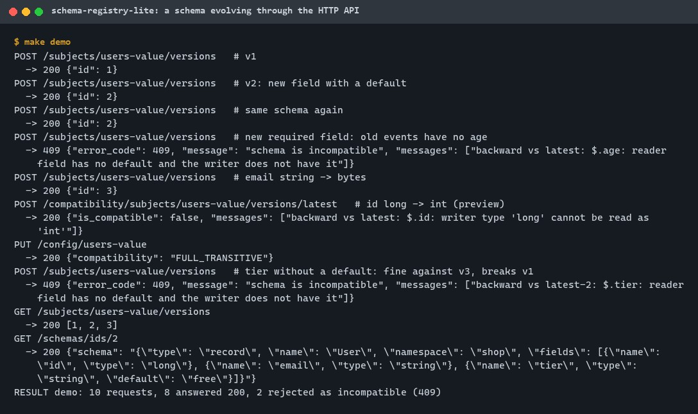
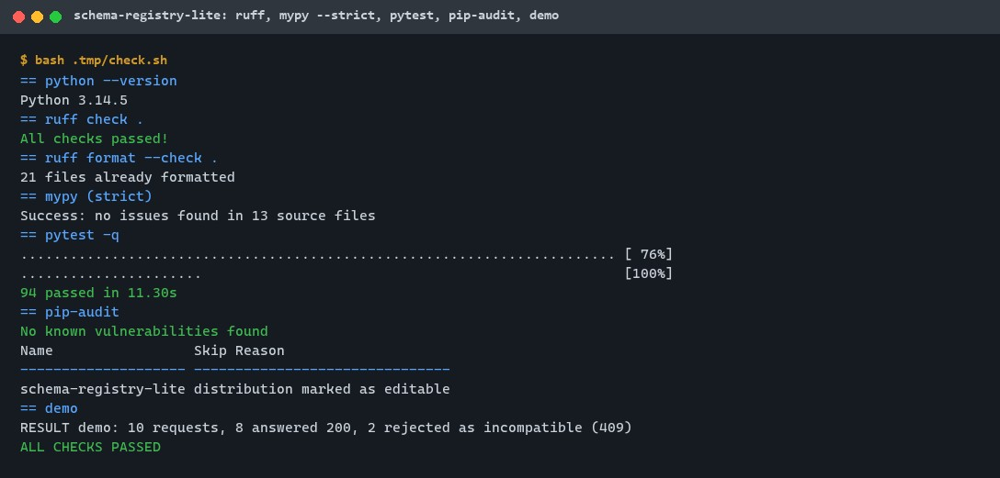
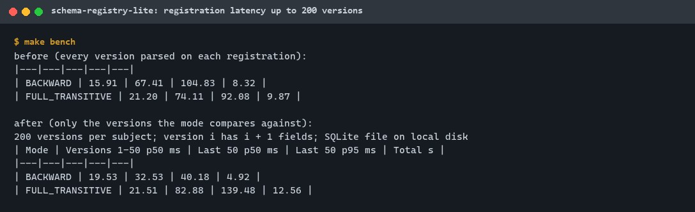
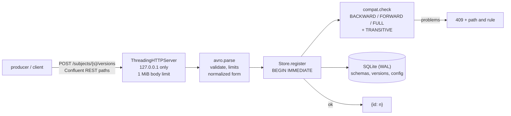
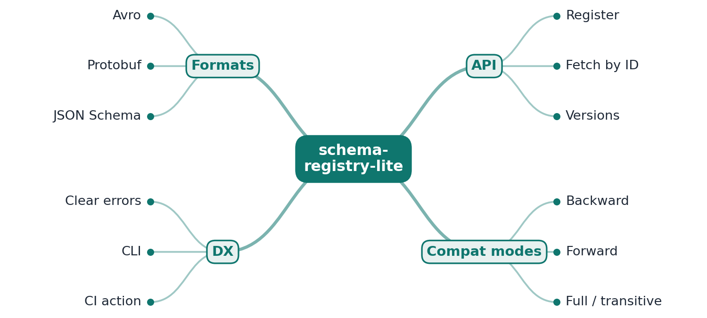

# schema-registry-lite

[](https://github.com/EquinoxWN/schema-registry-lite/actions/workflows/ci.yml)


> Stops a schema change from breaking every consumer of an event: a registry that rejects breaking changes and says exactly why.

Part of my **Data Engineering** list · Python

## Proof it works

A schema evolves through the HTTP API: compatible versions get global IDs and versions, the same
schema again returns its existing ID, and two breaking changes are rejected with 409 and the path
and rule that failed. The second is only caught because the subject uses a transitive mode:



94 tests pass, including a 28-case compatibility matrix and property tests over random schemas.
ruff and mypy --strict are clean, and pip-audit finds no known vulnerabilities:



Registration latency as one subject grows to 200 versions; the bench exposed that every earlier
version was parsed on each registration, and the fix halved BACKWARD's late median:



## Architecture

**What M1 runs today:**



**Full roadmap (M1 to M3):**



## How it works

_Steps 1 and 2 are built and tested (M1); the rest is on the [roadmap](#roadmap)._

1. Producers register a schema under a subject and receive a global ID and a version number.
2. Each new version is checked against earlier ones under the chosen mode: backward, forward, full or transitive.
3. Rules are implemented per format: reusing a Protobuf field number is breaking, while adding an Avro field with a default is not.
4. Rejections name the exact field and rule that failed.
5. A CLI and a GitHub Action run the same check in CI before deploy.
6. A compatibility matrix covers dozens of real-world change cases per format.

In M1 the format is Avro. Compatibility follows Avro's schema resolution rules: BACKWARD means the
new schema can read data written with the old one, FORWARD the reverse, FULL both, and the
TRANSITIVE variants compare with every earlier version instead of the latest. A schema's identity
is its normalized form, which ignores formatting and docs but keeps defaults
([ADR 0003](docs/adr/0003-identity-by-normalized-form.md)). Rejections already list the path and
the rule; per-format rule sets and stable rule names are M2.

## Who it helps

- **Who:** teams that produce and consume Avro events, and platform engineers who own the event
  contracts.
- **The problem:** a producer's schema change (a new required field, a narrowed type, a renamed
  record) breaks consumers that read old events or have not upgraded yet, often silently.
- **What M1 does:** a registry with the Confluent REST paths that assigns global IDs and versions,
  refuses incompatible versions under the subject's mode before any event is written, and returns
  the reason (`$.age: reader field has no default and the writer does not have it`).
- **How to use it:** run `srl serve`, point a producer's registry URL at it (or `curl` the paths
  below), set a mode with `PUT /config/{subject}`, and use `POST /compatibility/...` to preview a
  change in review before registering it.

## Tech stack

| Area | In M1 | Planned |
|---|---|---|
| API | Python 3.11+ standard library `http.server`, Confluent REST paths and error codes, loopback only | |
| Storage | SQLite (WAL), one serialized transaction per registration | Postgres for several registry processes |
| Formats | Avro 1.11: records, enums, arrays, maps, fixed, unions, named and recursive types | Protobuf and JSON Schema rules (M2) |
| Compatibility | NONE, BACKWARD, FORWARD, FULL and TRANSITIVE variants; reasons with paths | Stable rule names (M2), CLI and GitHub Action (M3) |
| Quality | ruff, ruff format, mypy --strict, pytest + Hypothesis (warnings are errors), pip-audit | Matrix of dozens of cases per format (M3) |

| Path | What it is |
|---|---|
| `src/schema_registry_lite/avro.py` | Parsing, validation, normalized form |
| `src/schema_registry_lite/compat.py` | Schema resolution and modes |
| `src/schema_registry_lite/store.py` | SQLite storage, IDs, versions, modes |
| `src/schema_registry_lite/server.py`, `cli.py` | HTTP API and `srl serve` |
| `scripts/demo.py`, `scripts/bench.py` | The API demo and the latency bench |

## Run it

Needs Python 3.11+ and make. Everything installs into `.venv/`; data goes to `data/` and scratch
files to `.tmp/`, both git-ignored.

```bash
python -m venv .venv && . .venv/bin/activate   # Windows: .venv\Scripts\activate
make setup   # pip install -e ".[dev]"
make lint    # ruff, ruff format --check, mypy --strict
make test    # 94 tests
make audit   # pip-audit
make demo    # the API on a temporary database
make bench   # registration latency over 200 versions
make serve   # srl serve --db data/registry.db --port 8081
```

With the server running:

```bash
curl -s -X POST localhost:8081/subjects/users-value/versions -H 'Content-Type: application/json' \
  -d '{"schema": "{\"type\":\"record\",\"name\":\"User\",\"fields\":[{\"name\":\"id\",\"type\":\"long\"}]}"}'
curl -s localhost:8081/subjects/users-value/versions/latest
curl -s -X PUT localhost:8081/config/users-value -H 'Content-Type: application/json' -d '{"compatibility":"FULL"}'
```

Endpoints: `GET /subjects`, `GET /subjects/{s}/versions`, `GET /subjects/{s}/versions/{n|latest}`,
`POST /subjects/{s}/versions`, `POST /subjects/{s}`, `GET /schemas/ids/{id}`,
`POST /compatibility/subjects/{s}/versions/latest`, `GET|PUT /config`, `GET|PUT /config/{s}`.

## Tests and results

Latest local run (full detail and the whole matrix in [docs/results/m1.md](docs/results/m1.md)):

| Test file | Tests | What it proves |
|---|---|---|
| `tests/test_avro.py` | 31 | 12 valid schemas (recursive and namespaced included); 16 invalid ones refused with the reason; limits; normalized form |
| `tests/test_compat.py` | 33 | 28 real-world changes with the right verdict under BACKWARD, FORWARD, FULL and NONE; reasons with paths; transitive modes; 3 properties over 200 random schemas each |
| `tests/test_store.py` | 15 | IDs and versions, idempotent re-registration, nothing stored on rejection, modes, preview, not-found, subject names, 12 concurrent registrations, restart |
| `tests/test_server.py` | 15 | The API over a real socket, 409 with reasons, Confluent error codes, a forged 50 MiB body refused unread, loopback-only CLI |

| Check | Result |
|---|---|
| Tests | 94 passed, 0 failed (warnings are errors) |
| Lint and types | ruff clean, ruff format clean, mypy --strict: no issues |
| Audit | pip-audit: no known vulnerabilities (no runtime dependencies) |
| Matrix | 28 Avro change cases: 8 fully compatible, 20 breaking in at least one direction |
| Demo | 10 requests: 8 answered 200, 2 rejected with 409 and the reason |
| Registration latency, 200 versions | BACKWARD median 19.5 ms early, 32.5 ms late (67.4 ms before the fix); FULL_TRANSITIVE 82.9 ms late |

The full local check passed twice.

## Roadmap

**M1** (≈8 h)
- [x] Write `docs/rfc/0001-design.md`: problem, goals, non-goals, chosen design
- [x] Producers register a schema under a subject and receive a global ID and a version number.
- [x] Each new version is checked against earlier ones under the chosen mode: backward, forward, full or transitive.

**M2** (≈8 h)
- [ ] Rules are implemented per format: reusing a Protobuf field number is breaking, while adding an Avro field with a default is not.
- [ ] Rejections name the exact field and rule that failed.

**M3** (≈9 h)
- [ ] A CLI and a GitHub Action run the same check in CI before deploy.
- [ ] A compatibility matrix covers dozens of real-world change cases per format.
- [ ] Publish the proof below with real numbers

## Proof

What this repo must show before it counts as done:

- The compatibility matrix published as a table, and the basic endpoints working with a standard registry client.

| Result | Value |
|---|---|
| Compatibility matrix | M1 has 28 Avro cases (table in [docs/results/m1.md](docs/results/m1.md)); dozens per format is M3 |
| Standard registry client against the endpoints | Not run yet (M3) |

## Why it matters

- **Interview angle:** 'Evolve event schemas without breaking consumers'.
- **Upstream I'd like to contribute to:** Apicurio Registry or Buf.

## Design docs

- [RFC 0001: design](docs/rfc/0001-design.md)
- [ADR 0001: record architecture decisions](docs/adr/0001-record-architecture-decisions.md)
- [ADR 0002: standard-library HTTP server and SQLite instead of FastAPI and Postgres](docs/adr/0002-stdlib-http-and-sqlite.md)
- [ADR 0003: identify schemas by a normalized form that keeps defaults](docs/adr/0003-identity-by-normalized-form.md)
- [M1 results](docs/results/m1.md)

## Scope

This is a learning and portfolio system, not a hosted production service. It runs as one process
on loopback with a local SQLite file, supports Avro only in M1, and has no authentication.

## Security and contributing

- Loopback only; body, schema size, depth and subject-name limits; parameterized SQL; no tracebacks
  in responses; one serialized transaction per registration.
- No runtime dependencies; every GitHub Action pinned to a commit SHA; workflows run read-only,
  without persisted credentials.
- Dependabot update pull requests are paused (`open-pull-requests-limit: 0`) so the repository keeps a single `main` branch; dependencies are updated by hand and checked by the CI audit.
- Report vulnerabilities privately: see [SECURITY.md](SECURITY.md). To contribute, see [CONTRIBUTING.md](CONTRIBUTING.md).

## License

MIT, see [LICENSE](LICENSE).
